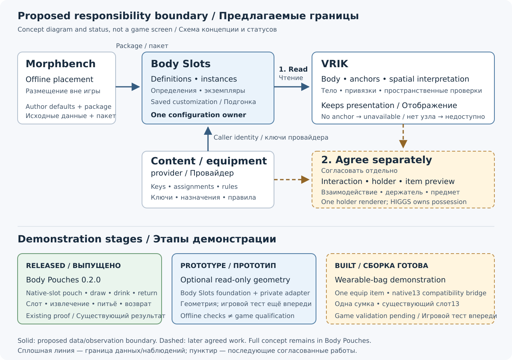

# Optional VRIK bridge: a proposal for Shizof

[Русская версия](vrik-integration-proposal-ru.md) · [Full concept](concept-en.md) · [Implementation status](implementation-status.md)

Shizof, thank you for VRIK and your support for Body Pouches. This proposal keeps the new slot manager in a separate Body Slots service. The first request for VRIK is an optional connection to that service, with the broader changes considered separately.

This brief selects one reviewable boundary from the existing [VRIK responsibilities](concept-en.md#vrik-body-hands-zones-and-slots) and [separate slot service](concept-en.md#separate-slot-mod-and-offline-authoring) sections. The full concept remains maintained only here in Body Pouches.

## What each participant would own

Body Slots owns authored definitions, stable keys, logical instances, local placement/access geometry and saved customization. An equipment provider supplies durable equipment identity; the registry does not guess item IDs. Morphbench authors defaults offline. Body Pouches owns potion selection and gameplay assignments, while HIGGS retains physical possession.

VRIK keeps the calibrated body, anchor mapping, spatial hand interpretation and its presentation domain. It reads committed slot data and reports what can actually bind. Missing anchors remain unavailable. It does not become a second writer of saved slot configuration. In the target design, a holder and its item preview remain separate, with one declared renderer for the holder to avoid duplicating an equipment model.

## Start with an optional read-only bridge

The first discussion can stay body-anchor-only: negotiate the separate provider, copy versioned definitions outside the per-hand hot path, resolve named anchors after VRIK's body update, and expose copied world geometry plus availability. Provider absence preserves the existing native path. This step supplies observations; interaction decisions and new rendering require separate agreement.

The [private draft MR](https://github.com/Vhodnoylogin/vrik-reconstruction/pull/1) makes that first boundary inspectable. Its isolated `f392…` prototype has this measured diff:

| Scope | Change |
|---|---|
| Existing `main.cpp` | 8 added lines |
| Existing `vrikbody.cpp` | 11 added lines |
| Entire first prototype | 10 files; 506 additions; 0 removals |

The other files introduce adapter code and documentation. These numbers describe **only the first read-only prototype**, not the effort or risk of full integration, interaction or rendering.

The MR uses private reconstructed source, which is not authoritative maintainer source. No closed-source excerpts are reproduced here or proposed for public distribution. Its independently defined adapter boundary can be adapted to your implementation and conventions; accepting the reconstruction is not a prerequisite for discussing it.

## A demonstration with an honest status

[Released Body Pouches 0.2.0](https://www.nexusmods.com/skyrimspecialedition/mods/194796) already demonstrates a native-slot potion pouch: assignment, visible potion preview, drawing, drinking/return and save persistence using released VRIK/HIGGS. That is the existing proof, with the released mod's documented limitations.

The private wearable-bag demonstration for your review is **in development**, not working proof yet. Its deliberately small first version uses one unique equip item, a real Body Slots instance and released VRIK's existing native13 interaction/Art path. Equipping enables the instance; unequipping stops new actions and hides the bag, while an already delivered potion retains its ordinary disposition. This is a compatibility bridge, not arbitrary new-slot rendering or support for several interchangeable bag copies. The existing concept describes the later path through offline authoring and generic runtime binding. Equipment-node binding, independent presentation and actual game behavior still need separate qualification.

I would welcome your judgement on the ownership split and a suitable optional read-only integration point first. We can then agree separately on lifecycle, content/presentation observations and any interaction requests, preserving the original fourteen holsters and existing consumers. The proposal does not assign implementation or maintenance commitments to you.
