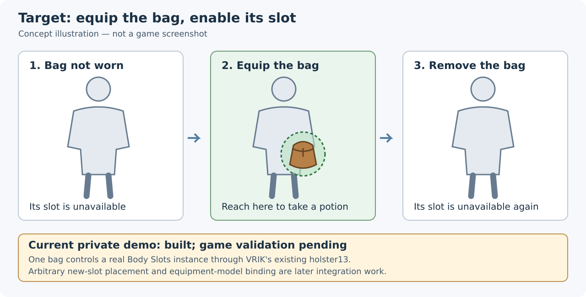

# Общие службы и Body Slots: предложение для Shizof

[English](vrik-integration-proposal-en.md) · [Полная концепция](concept-ru.md) · [Статус реализации](implementation-status.md)

Shizof, спасибо за VRIK и помощь с Body Pouches. Его выпуск показал, как много может сделать небольшой мод, используя существующие основные моды. Одновременно обнаружилась повторяющаяся трудность: если интерфейса недостаточно, стороннему моду приходится заново реализовывать управление слотами, согласование ввода или части внутреннего поведения другого мода.

## Идея за одну минуту

Каждый основной мод сохраняет свою ответственность и предоставляет другим модам данные и запросы на действия. Мод зелий определяет, какое зелье предложить, а тело, слоты и физическое обращение с предметом получает через общие службы.

| Участник | Предлагаемая ответственность |
|---|---|
| HIGGS | Согласование ввода контроллеров, физические руки, захват и владение предметом |
| VRIK | Откалиброванное тело игрока, положение виртуальных рук, точки крепления, пространственное взаимодействие со слотами и согласованная ответственность за отображение |
| PLANCK | Физическая анимация NPC, жизненный цикл ragdoll и физические удары |
| Body Slots | Создание и настройка слотов; хранение определений, отдельных экземпляров и сохранённой подгонки |
| Игровой мод | Его предметы, правила выбора и игровая механика, использующие эти службы |

Это границы существующей концепции, а не утверждение, что весь общий API уже реализован. Вторым этапом работа с адресами и повторяющиеся технические операции движка выносятся в CommonLib; игровые решения остаются у модов.

## Конкретная цель: надеваемая сумка зелий

Надели сумку — её слот доступен там, где сумка висит. Потянулись к ней — достали зелье через привычное взаимодействие VRIK/HIGGS. Сняли сумку — слот недоступен. Другой мод мог бы предложить другой держатель и свои правила предметов через те же службы.

Body Slots хранит описание, размещение и настройки слота. Мод экипировки сообщает, какая конкретная сумка надета. VRIK привязывает слот к фактическому телу и определяет, дотянулась ли рука. HIGGS работает с физическим зельем. Модель держателя и изображение его содержимого остаются разными объектами; за показ держателя отвечает один явно выбранный участник.

## Что готово, а что ещё нет

- **Выпущено:** Body Pouches 0.2.0 использует существующую кобуру VRIK для назначения, извлечения, питья, возврата и сохранённого выбора зелий.
- **Собрано и проверено вне игры:** отдельные плагин Body Slots и SDK с определениями, экземплярами, сохранённым размещением и включением слотов. Архивы загружены в неопубликованный черновик Nexus.
- **Подготовлена демонстрация:** один надеваемый предмет управляет настоящим экземпляром Body Slots через существующую кобуру13 выпущенного VRIK. Фактическая экипировка, изображение и действия с зельями ещё требуют игровой проверки. Произвольные новые слоты и привязку к модели экипировки этот пример пока не демонстрирует.
- **Доступно отдельно:** [экспериментальный Morphbench Slots](https://github.com/Vhodnoylogin/morphbench/releases/tag/v0.8.0-slots.1) для размещения исходных слотов вне игры.

[Разбор обновлений VRIK 0.8.8 и PLANCK](upstream-update-2026-10-26.md) отделяет текущие данные о совместимости от предстоящих игровых проверок.

## Небольшая первая граница для обсуждения

Имеет ли смысл необязательный мост, через который VRIK читает определения слотов, сопоставляет именованные точки крепления после обновления тела и сообщает положение и доступность? Данные копируются вне горячего пути обработки рук. Отсутствие Body Slots сохраняет исходный нативный путь. Первый шаг даёт пространственные наблюдения; взаимодействие с новыми слотами и их отображение согласуются отдельно, сохраняя исходные четырнадцать кобур и существующих потребителей.

[Первый ограниченный MR](https://github.com/Vhodnoylogin/vrik-reconstruction/pull/1) показывает эту границу. [Обзор всей текущей работы](https://github.com/Vhodnoylogin/vrik-reconstruction/pull/2) теперь содержит VRIK и всю историю Body Slots в отдельных каталогах одного приватного репозитория. Обе ссылки требуют доступа. Работа над VRIK использует приватную реконструкцию на основе 0.8.7: она ещё не перенесена на 0.8.8 и не является авторитетными исходниками сопровождающего. Предлагаемую границу можно адаптировать к вашей реализации без принятия этой реконструкции.

## Ваш отзыв определит следующий шаг

1. Соответствует ли вашему представлению о VRIK отдельный необязательный мод, владеющий определениями слотов и сохранённой подгонкой?
2. Подходит ли мост точек крепления как первый шаг, или вы предпочли бы другую границу либо существующий API?
3. Какие части взаимодействия с произвольными слотами и их отображения должны остаться в VRIK, и что следует изменить перед продолжением?

Я могу помочь с анализом кода и черновиками реализации с использованием AI для вашего рассмотрения, без финансовых затрат с вашей стороны. Предложение не предполагает обязательств по реализации или сопровождению с вашей стороны. Единственным поддерживаемым описанием общей архитектуры остаётся [полная концепция](concept-ru.md); эта страница — краткое введение в неё.
